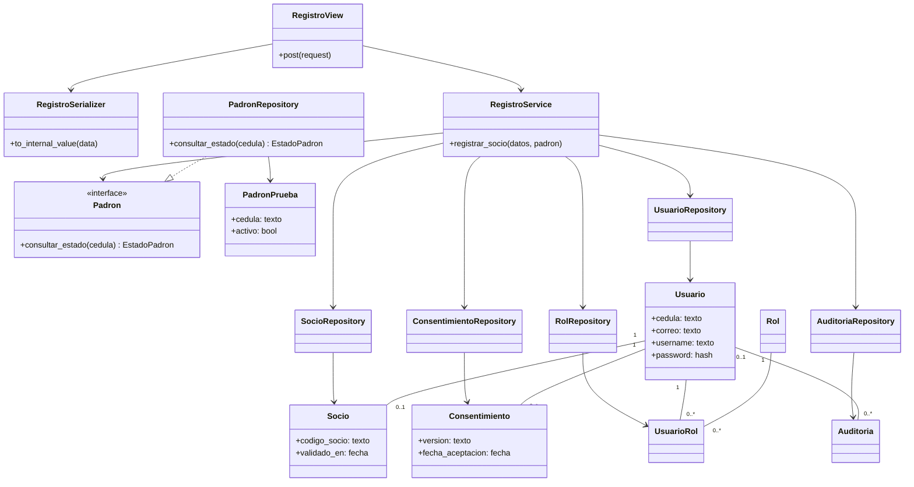
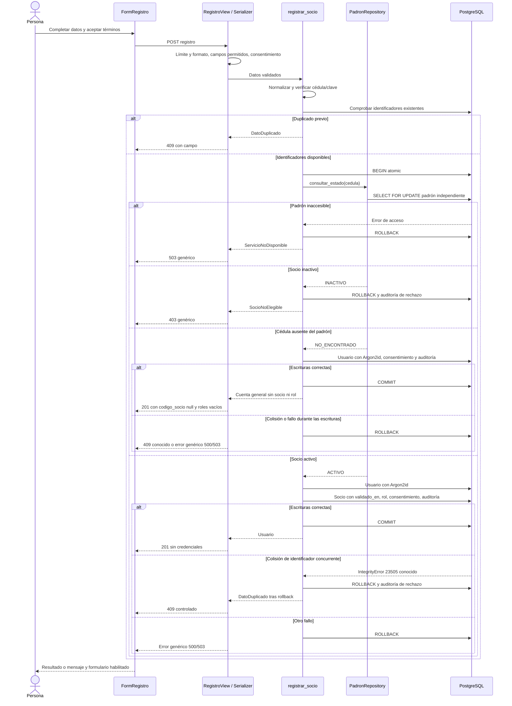

# Arquitectura y contrato del registro de cuentas

Revisión de cierre del 10 de noviembre: [108 pruebas y aceptación por requisito](cierre-valeria-sprint-1.md). Los [diagramas exportados y sus fuentes vigentes](diagramas/README.md) incluyen también el login. La creación compartida de socio reintenta selectivamente colisiones de código con savepoints.

Regla vigente desde el 9 de noviembre de 2026: por decisión posterior del usuario, una cédula válida ausente del padrón puede crear una cuenta general. El padrón activo sigue siendo obligatorio para obtener la condición y los permisos de socio. Véase [la decisión y sus pruebas](decision-registro-general.md).

Decisión posterior del mismo día: [la cédula solo exige diez dígitos](decision-cedula-diez-digitos.md), sin provincia ni verificador. Se corrigió además el esquema faltante de la base local original para que la aplicación habitual pueda registrar cuentas generales.

La implementación conserva un monolito modular por capas. Añade un puerto de consulta al padrón y un adaptador PostgreSQL porque permiten sustituir la consulta en pruebas sin acoplar el servicio al esquema. No se añaden microservicios, contenedores de inyección ni un repositorio genérico.

## Responsabilidades y decisiones

| Capa | Implementación | Responsabilidad |
| --- | --- | --- |
| Presentación React | FormRegistro y validaciones.js | Formulario, mensajes y estado de envío; la autoridad permanece en el servidor |
| API | RegistroView y RegistroSerializer | Formato, campos permitidos, consentimiento booleano explícito y HTTP |
| Aplicación | registrar_socio | Normalización, coordinación, política de registro y transacción |
| Reglas | validar_cedula, comprobación de consentimiento y elegibilidad | Diez dígitos, aceptación y tipo de cuenta según padrón |
| Puerto | Protocol Padron y EstadoPadron | Distinguir activo, inactivo y no encontrado sin transportar datos personales |
| Adaptadores | PadronRepository y repositorios existentes | ORM parametrizado y persistencia PostgreSQL |
| Persistencia | SQL 05/06 y restricciones existentes | Diez dígitos, unicidad final e integridad, incluso con escrituras concurrentes |

La inyección es un argumento opcional `padron` del servicio. En el flujo HTTP se usa el adaptador PostgreSQL por defecto. Un adaptador alternativo devuelve un valor de `EstadoPadron`: ACTIVO, INACTIVO o NO_ENCONTRADO. Un fallo de consulta o un resultado desconocido impiden crear cualquier cuenta. Se conserva el nombre interno histórico `registrar_socio`; el servicio ahora coordina ambas clases de cuenta.

Se conserva el modelo `managed=False`: el esquema evoluciona mediante SQL versionado. No se genera una migración Django que compita con los scripts de la base.

## Normalización y privacidad

Cédula: texto con ceros iniciales; se eliminan espacios exteriores y se exigen exactamente diez dígitos ASCII. No se calcula verificador ni se comprueba provincia. Esta validación de formato no prueba identidad ni pertenencia: para el rol de socio se exige además el padrón activo.

Correo y username se almacenan con trim exterior y minúsculas. Los repositorios consultan `lower(trim(...))` y los nuevos índices usan `lower(btrim(...))`, incluyendo espacios ordinarios exteriores en escrituras directas. Los índices anteriores permanecen. No se modifican cuentas históricas para normalizarlas ni se fusionan duplicados.

El padrón contiene únicamente cédula sintética y estado activo. No tiene relación obligatoria con usuario y no dispone de endpoint público. Ausente produce una cuenta general; inactivo conserva el rechazo genérico. Esta diferencia reemplaza expresamente la igualdad de respuestas exigida por la línea base original; el comportamiento de registro permite inferir una diferencia entre ambos casos. El contrato existente mantiene errores por campo para cuentas duplicadas.

## Contrato HTTP

`POST /api/auth/registro/`, sin autenticación, conserva el límite existente de 30 solicitudes anónimas por minuto. Solo acepta: `cedula`, `nombre`, `apellido`, `correo`, `username`, `telefono`, `fecha_nacimiento`, `clave`, `acepta_terminos`.

```json
{
  "cedula": "0100000009",
  "nombre": "Socio",
  "apellido": "Sintético",
  "correo": "socio@example.test",
  "username": "socio01",
  "telefono": "0990000000",
  "fecha_nacimiento": "2000-01-01",
  "clave": "Ejemplo1234",
  "acepta_terminos": true
}
```

El ejemplo usa datos sintéticos y una clave ilustrativa; no constituye una cuenta precargada. Solo `true` booleano es válido para consentimiento. Campos desconocidos, incluidos activo, estado, roles, validado_en y resultado_validacion, se rechazan con 400. La cédula JSON numérica se rechaza para no perder ceros.

| Situación | HTTP | Respuesta |
| --- | --- | --- |
| Socio activo registrado | 201 | id, username normalizado, nombre, apellido, codigo_socio, roles=[Socio] |
| Cédula válida ausente del padrón | 201 | mismos campos; codigo_socio=null, roles=[] |
| Formato, campos desconocidos o consentimiento API | 400 | Contrato DRF existente: campo → lista de mensajes |
| Cédula con longitud incorrecta o caracteres no numéricos | 400 | error.codigo=cedula_invalida, campo=cedula |
| Consentimiento omitido o falso en llamada al servicio | 400 | error.codigo=consentimiento_requerido, campo=acepta_terminos |
| Identificador duplicado | 409 | error.codigo=dato_duplicado, campo=cedula/correo/username |
| Socio inactivo en padrón | 403 | error.codigo=socio_no_elegible, campo=null, mensaje genérico |
| Fallo PostgreSQL/padrón | 503 | error.codigo=servicio_no_disponible, mensaje genérico |
| Fallo inesperado/integridad desconocida | 500 | error.codigo=error_interno, mensaje genérico |
| Límite de solicitudes | 429 | Contrato DRF de throttling existente |

Las respuestas de negocio conservan `{ "error": { "codigo": "...", "mensaje": "...", "campo": null } }`. No devuelven contraseñas, hashes, SQL, rutas o trazas. React ya interpreta este contrato, por lo que no fue necesario sustituir su cliente HTTP.

## Transacción y concurrencia

Las comprobaciones previas ofrecen un error claro. Después, `transaction.atomic` engloba la consulta del padrón, usuario, consentimiento y auditoría de éxito; únicamente para ACTIVO se añaden socio y rol. `select_for_update` mantiene bloqueada la fila existente del padrón hasta el commit para que el estado consultado no cambie durante el alta. La consulta de una fila ausente no bloquea futuras inserciones: una posterior incorporación al padrón no otorga privilegios automáticamente a la cuenta general. No hay efectos externos ni envíos de correo dentro de esta transacción.

Solo después de confirmar `EstadoPadron.ACTIVO` se asigna `validado_en` con hora del servidor y se crea el socio. Una cuenta general no tiene fila socio, fecha de validación, código de socio ni rol asignado. Puede autenticarse y consultar su propio perfil en `/mi-cuenta`; las áreas protegidas se siguen autorizando en el servidor. Si ocurre un fallo, se revierte el conjunto. Las auditorías de rechazo por cédula inválida, falta de elegibilidad o colisión concurrente se insertan sin cédula, correo ni credenciales. No se promete auditar indisponibilidad de una base que impide guardar auditoría.

`IntegrityError` de identificadores se captura fuera del bloque atómico, tras el rollback. Solo SQLSTATE 23505 con las restricciones conocidas de cédula/correo/username se convierte en duplicado. Los nombres reconocidos están en `RESTRICCIONES_DUPLICADO`. Las colisiones de socio_codigo_socio_key se resuelven dentro del creador compartido de socio: un savepoint por inserción, hasta tres intentos, sin dejar la transacción exterior rota. El generador prueba como máximo diez candidatos por llamada. Otros errores de integridad no se reinterpretan. Agotar el código genera 503 y revierte el registro o la conversión; nunca se comunica como duplicación de cuenta.

## Diagrama de clases



`RegistroService` representa el módulo funcional existente, no una clase artificial añadida al código. El padrón se relaciona por consulta de cédula, no por creación de una cuenta.

## Diagrama de secuencia


