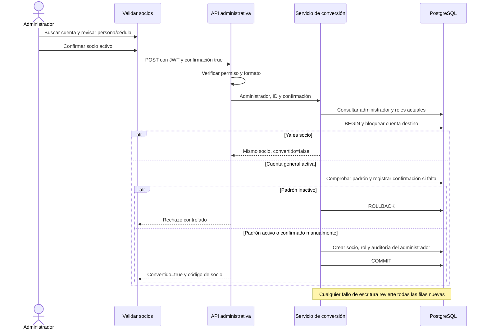

# Validación administrativa temporal para convertir cuentas a socio

Actualización del 10 de noviembre: el creador compartido de socio usa savepoints y reintentos selectivos del código. El [cierre actual](cierre-valeria-sprint-1.md) recoge 108 pruebas aprobadas y [los diagramas SVG](diagramas/README.md) del flujo vigente. La evidencia de 99 pruebas de este documento corresponde a la revisión original de la función temporal.

## Autorización y alcance

El usuario pidió implementar temporalmente el proceso para que un administrador valide y convierta cuentas generales mientras se definen las reglas finales. Esta ampliación reemplaza la limitación anterior que solo permitía asignar Socio durante el registro inicial.

La aprobación es manual y provisional: el administrador declara expresamente que revisó la cuenta y que la persona es socia activa. El sistema no valida documentos ni consulta un sistema institucional. No existe un botón para que un usuario general se otorgue el rol por sí mismo.

## Cómo utilizarlo

1. Entrar como administrador en la misma instancia donde se creó la cuenta general. La aplicación habitual es http://localhost:5173; la demo 5174 utiliza otra base.
2. Abrir Administración → **Validar socios**, o visitar http://localhost:5173/admin/validar-socios.
3. Buscar por usuario, nombre, apellido o cédula. Para el caso solicitado, buscar `diego2026`.
4. Pulsar **Revisar y convertir** y comprobar que la persona y su cédula sean correctas.
5. Marcar la confirmación de socio activo y pulsar **Validar y convertir a socio**.
6. La persona puede pulsar **Comprobar mi condición de socio** en Mi cuenta para actualizar su acceso. También puede recargar la página o volver a iniciar sesión. Conserva usuario y contraseña.

Se preparó `admin.validacion` como cuenta administrativa temporal en la base local original, porque no había administradores activos. Sus credenciales se entregan al usuario en el chat, sin incluirlas en los archivos del repositorio. No se resetearon claves ni se modificaron roles de las cuentas anteriores. `diego2026` quedó disponible para revisión: no fue convertido automáticamente durante la implementación.

## Reglas provisionales

| Situación | Resultado |
| --- | --- |
| Administrador activo y cuenta general activa sin roles | Permite confirmar y convertir |
| Cédula no encontrada en padrón | Registra la confirmación manual como activa y convierte, en una transacción |
| Cédula activa en padrón | Reutiliza la fila y convierte |
| Cédula inactiva en padrón | Rechaza; no reactiva ni modifica la fila |
| Cuenta suspendida o desactivada | Rechaza |
| Cuenta interna con otro rol | Rechaza; no amplía sus privilegios |
| Ya tiene fila socio y rol Socio | Responde que ya es socia; no duplica ni vuelve a auditar |
| Fila socio y rol inconsistentes | Rechaza para revisión, sin reparar silenciosamente |
| Confirmación ausente, falsa o de tipo distinto a booleano true | Rechaza |
| Usuario general, socio, Marketing o administrador suspendido/sin rol vigente | No puede aprobar |
| Fallo del padrón, del rol o de auditoría | Rollback completo, sin conversión parcial |

La aprobación no modifica la contraseña, username, correo, estado ni el consentimiento ya existente. Añade únicamente la fila de padrón cuando falta, socio con código y fecha, rol Socio y auditoría. No se admiten cambios de cédula, roles arbitrarios o credenciales en la petición de conversión.

## Arquitectura y seguridad

Se conservan las capas del proyecto. La vista aplica autenticación JWT y permiso Administrador; el serializador valida la confirmación; el servicio comprueba otra vez al administrador contra su estado y roles actuales en la base. Los repositorios hacen las consultas mediante ORM.

La cuenta destino se bloquea con select_for_update dentro de atomic. Dos administradores concurrentes obtienen el mismo socio: uno convierte y el otro recibe una respuesta idempotente. Padrón, socio, rol y auditoría se guardan juntos; un fallo revierte todas esas escrituras. El generador de código se comparte con el registro inicial; la restricción SQL conserva la garantía final frente a colisiones.

La auditoría guarda acción CONVERTIR_SOCIO, administrador actor, entidad socio, ID de la cuenta destino, fecha, resultado e IP. No guarda la contraseña, correo ni cédula completos en la bitácora. La pantalla general de Auditoría que ya existía sigue siendo demostrativa; el evento real de esta función se guarda en la tabla auditoria.

El listado administrativo está paginado de veinte en veinte y solo muestra cuentas generales. Incluye nombre, username, cédula, estado de cuenta y estado del padrón, necesarios para la revisión autorizada. No devuelve hashes, claves, tokens ni correos.

## Contrato HTTP

Ambas rutas requieren un administrador autenticado:

- GET `/api/auth/administracion/cuentas-generales/?q=diego2026&page=1`: lista paginada con count, next, previous y results.
- POST `/api/auth/administracion/cuentas/<id>/convertir-socio/`: acepta únicamente `{"confirmar_socio_activo": true}`.

La conversión devuelve 200 con id, convertido, codigo_socio, validado_en y mensaje. convertido=true identifica una nueva conversión; false indica que ya era socio. Errores: 400 confirmación, 401 sin sesión, 403 sin autorización o padrón inactivo, 404 cuenta inexistente, 409 cuenta no elegible/inconsistente y 500/503 ante fallo interno o infraestructura. Los errores conservan el contrato seguro existente.

El cliente HTTP ahora permite POST autenticado con la misma renovación de token que GET. El endpoint de perfil y los permisos por área consultan roles actuales en base: la misma sesión puede reconocer el nuevo rol después de refrescar el perfil, sin cambiar la contraseña.

## Habilitación y retirada del proceso temporal

La configuración CONVERSION_SOCIOS_TEMPORAL_HABILITADA se encuentra habilitada por defecto para esta implementación local autorizada. Para impedir nuevas validaciones, establecer en el entorno del backend:

```powershell
$env:CONVERSION_SOCIOS_TEMPORAL_HABILITADA = 'False'
```

Reiniciar el backend para aplicar el cambio. Se puede usar también su configuración local habitual. Con la opción deshabilitada, listado y conversión devuelven 503 controlado. La desactivación no revoca conversiones realizadas ni borra el padrón o la auditoría; no se implementó caducidad automática. Esa política queda pendiente de la definición final solicitada por el usuario.

No se necesitan migraciones ni nuevos cambios SQL: se reutilizan las tablas preparadas por SQL 01–06. La cuenta administrativa temporal permanece hasta que el responsable la desactive; no se programó su eliminación automática. No se hizo commit ni publicación.

## Pruebas y resultados

Suite completa: **99 pruebas aprobadas**, PostgreSQL real, 21.155 s. La nueva cobertura está en backend/apps/usuarios/tests/test_conversion_socio.py:

| Criterio | Evidencia |
| --- | --- |
| Solo administrador | Sin autenticación, roles general/Marketing/socio, administrador suspendido y rol revocado |
| Revisión expresa | Confirmación obligatoria y booleana, rechazo de roles suministrados por cliente |
| Consulta administrativa real | Filtrado y exclusión de cuentas internas y socios; campos mínimos |
| Conservación de la cuenta | Usuario, correo, hash y consentimiento permanecen iguales |
| Conversión íntegra | Padrón activo, socio con fecha, rol y auditoría del administrador |
| Sin reactivaciones indebidas | Padrón inactivo no cambia; cuenta suspendida o con otro rol se rechaza |
| Repeticiones seguras | Segunda aprobación no duplica socio, rol ni auditoría |
| Fallos sin datos parciales | Fallo al asignar rol, auditar o consultar padrón |
| Temporalidad | Deshabilitación mediante configuración |
| Sesión posterior | Perfil y permiso de socio actualizados con la misma sesión; administrador sigue denegado |
| Concurrencia real | Dos administradores, conexiones PostgreSQL diferentes, una sola conversión |

React: build aprobado, 55 módulos transformados. Lint: salida 0 con las 14 advertencias anteriores de Fast Refresh en paneles; la nueva pantalla no añade advertencias.

Comprobación HTTP real en la base demo separada: alta general 201, conversión administrativa 200, repetición idempotente y acceso de socio 200 con la sesión previa. Se dejó la cuenta sintética revision.conversion como evidencia en la demo. En la base original solo se creó el administrador temporal y se verificó su login 200 y la disponibilidad de diego2026 en el listado administrativo 200.

La inspección visual manual no pudo ejecutarse: la herramienta de control del navegador informó que el host no estaba disponible. No se presenta esa revisión como realizada.

## Secuencia de aprobación


